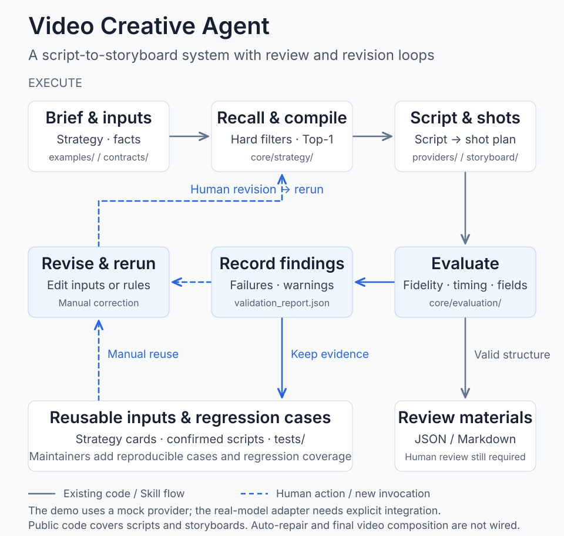

# Video Creative Agent

[简体中文](README.md) · **English**

An open engineering baseline for Chinese talking-head video content: it compiles a Brief into a fact-bounded script request, then turns the confirmed script into a reviewable, verifiable, and exportable storyboard.

## Architecture



[Diagram sources, implementation boundaries, and maintenance](docs/architecture.md) (Chinese)

## Output Showcase

Two finished advertising videos generated by the product demo. Click either animated preview to view the full video.

| Script → assembly | Reference → remix |
| --- | --- |
| [](https://github.com/esmile-collab/video-creative-agent/blob/main/showcase/media/script-assembly.mp4) | [](https://github.com/esmile-collab/video-creative-agent/blob/main/showcase/media/reference-remix.mp4) |
| Personal care · product explainer · full video about 60 seconds | Education · game-development course · full video about 95 seconds |

The public code currently covers the script and storyboard workflow. These finished videos showcase outputs from the product demo. Further industries, formats, and strategies will be collected in the [showcase](showcase/README.md).

## Current Loop

```text
Brief
→ strategy-card hard filters + Top-1 recall
→ script request compilation
→ confirmed script
→ deterministic semantic splitting + time budgeting
→ shot types & captions
→ structural checks
→ JSON / Markdown export
```

The repo uses a Mock Provider by default, so the full demo runs without an API key. `core/providers/openai-compatible.mjs` provides an adapter for real models; keys are read only from server-side environment variables.

See [`docs/PRD.md`](docs/PRD.md) for the full product scope, frontend information architecture, and launch acceptance criteria; see [`MIGRATION_REPORT.md`](MIGRATION_REPORT.md) for the trade-offs made when open-sourcing the project.

## Quick Start

```bash
npm test
npm run demo
npm run safety
```

Demo output is written to `outputs/demo_001/`, which is excluded from Git by default.

## External Reference Videos

`examples/demo_001/public-sources.json` stores three publicly accessible video URLs, video IDs, and titles, documenting where the strategies came from and how external references relate.

External reference videos remain source links only; their binaries, full transcripts, and extracted frames are not redistributed here. The output showcase contains product-demo videos supplied and designated for public display by the project owner.

## Core Directories

```text
core/strategy/       strategy-card validation, recall & script request compilation
core/storyboard/     script splitting, shot planning & storyboard rendering
core/evaluation/     structural gates & cut-point evaluation
core/providers/      mock & compatible model adapters
contracts/           public data contracts
examples/demo_001/   demo inputs free of internal business data
scripts/             demo, desensitization scan & verification entry points
tests/               core behavior tests
docs/                product scope & data boundaries
```

## Current Boundaries

- Provided: strategy recall, fallback, script request compilation, confirmed-script-to-storyboard, automatic structural gates, and external public video references.
- Not yet provided: automatic video understanding, automatic strategy-card production, real asset recall, TTS (text-to-speech), multiple renderers, and final-cut composition.
- The automatic gates only indicate structural viability; visual quality still requires human review or controlled blind evaluation.

## License

Code is under the [MIT License](LICENSE). `package.json` stays `private: true` to prevent accidental publication as an npm package.
