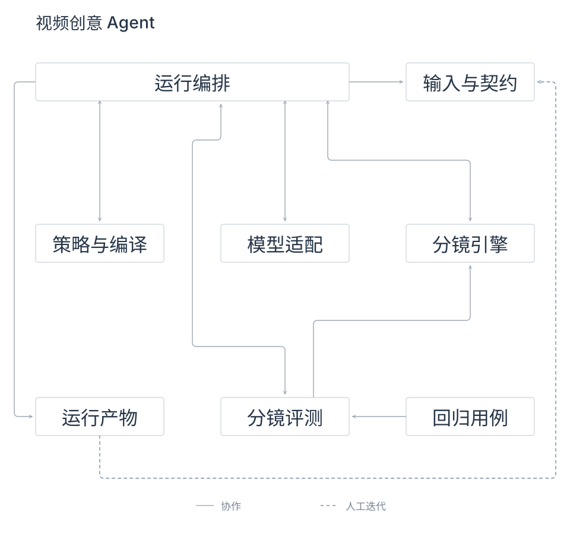

# Video Creative Agent（视频创意 Agent）

**简体中文** · [English](README.en.md)

一个面向中文口播内容的公开工程基线：把 Brief（任务简报）编译成有事实边界的脚本请求，再把确认脚本转换成可审阅、可校验、可导出的分镜。

## 系统架构



[图源、实现边界与维护](docs/architecture.md)

## 成果展示

下面是产品 Demo 跑出的两条广告成片。点击动态预览可查看完整视频。

| 脚本 → 组装 | 爆款参考 → 裂变混剪 |
| --- | --- |
| [](https://github.com/esmile-collab/video-creative-agent/blob/main/showcase/media/script-assembly.mp4) | [](https://github.com/esmile-collab/video-creative-agent/blob/main/showcase/media/reference-remix.mp4) |
| 日化 · 产品讲解 · 完整成片约 60 秒 | 教育 · 游戏开发课程 · 完整成片约 95 秒 |

公开代码当前覆盖脚本与分镜工作流，以上成片用于展示产品 Demo 的生成效果。更多行业、体裁和策略的样例统一收录到 [成果样例库](showcase/README.md)。

## 当前闭环

```text
Brief（任务简报）
→ 策略卡硬过滤与 Top-1（第一名）召回
→ 脚本请求编译
→ 确认脚本
→ 确定性语义切分与时间预算
→ 画面类型与 Caption（画面描述）
→ 结构校验
→ JSON / Markdown（结构化数据 / 可读文档）导出
```

仓库默认使用 Mock Provider（模拟模型供应方），无需 API Key（接口密钥）即可运行完整 Demo（演示）。`core/providers/openai-compatible.mjs` 提供真实模型适配器，密钥只从服务端环境变量读取。

完整产品范围、前端信息架构和上线验收见 [`docs/PRD.md`](docs/PRD.md)，公开迁移取舍见 [`MIGRATION_REPORT.md`](MIGRATION_REPORT.md)。

## 快速开始

```bash
npm test
npm run demo
npm run safety
```

Demo 输出写入 `outputs/demo_001/`，该目录默认不进入 Git。

## 外部参考视频

`examples/demo_001/public-sources.json` 保存三个 C 端可访问的视频 URL（链接）、视频 ID 和标题，用于说明策略来源与外部参考关系。

外部参考视频只保留来源链接，不在本仓库分发其视频二进制、完整字幕或抽帧。上方成果展示收录的是项目所有者本次提供并指定公开的产品 Demo 成片。

## 核心目录

```text
core/strategy/       策略卡校验、召回与脚本请求编译
core/storyboard/     脚本切分、画面规划与分镜渲染
core/evaluation/     结构门禁与切点评测
core/providers/      Mock 与兼容模型适配器
contracts/           可公开的数据契约
examples/demo_001/   无内部业务数据的演示输入
scripts/             Demo、脱敏扫描和验证入口
tests/               核心行为测试
docs/                产品范围与数据边界
```

## 当前边界

- 已提供：策略召回、回退、脚本请求编译、确认脚本到分镜、自动结构门禁、外部公开视频引用。
- 尚未提供：自动视频理解、策略卡自动生产、真实素材召回、TTS（语音合成）、多渲染器和成片合成。
- 自动门禁只说明结构可用，画面质量仍需人工确认或受控盲评。

## 许可证

代码采用 [MIT License](LICENSE)。`package.json` 保持 `private: true`，用于防止误发布为 npm（Node 包管理器）软件包。
